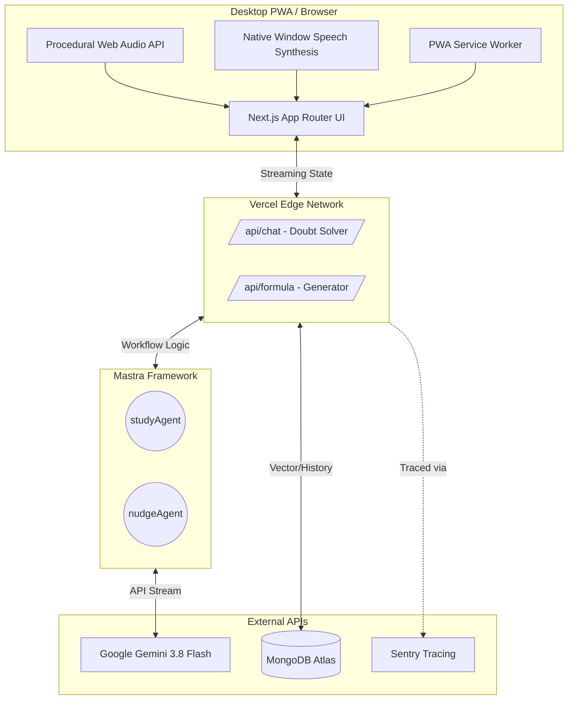

# 🏛️ SiloFocus

> A privacy-first, zero-runtime-cost AI study companion and kinetic timepiece. Built with Google Gemini Flash, procedural audio, and an Apple-grade kinetic UI.

[](https://nextjs.org)
[](https://developer.mozilla.org/en-US/docs/Web/Progressive_web_apps)
[](https://aistudio.google.com/)
[](https://vercel.com)
[](https://opensource.org/licenses/MIT)


*Above: SiloFocus running the Vintage Split-Flap topology in mode.*

**SiloFocus** was originally prototyped as a Hacktoberfest project to help a student conquer 12th Board Exam burnout. It has since been re-architected into a production-grade, installable Progressive Web App (PWA).

Powered by **Google Gemini 3.8 Flash**, SiloFocus delivers elite STEM tutoring, procedural soundscapes, and active recall quizzes within a highly optimized, distraction-free desktop environment.

---

## 🧠 System Architecture



---

## 🏛️ The 5 Pillars of Engineering

### I. Kinetic Timepiece Topologies
SiloFocus features an Apple-grade kinetic animation engine featuring 60fps hardware-accelerated digit rolling (`tabular-nums` + `translate3d`).

| Topology | Description |
| :--- | :--- |
| **Editorial Radial** | Serif numerical display encased in a continuous SVG progress ring. |
| **Vintage Split-Flap** | Mechanical flip cards using CSS 3D perspective (`rotateX(-180deg)`). |
| **Bauhaus Analog** | Clean minimalist dial with second and minute sweep hands. |
| **Linear Pillar** | Mercury-column vertical progress bar with GPU-accelerated scaling. |

### II. Procedural Web Audio Engine
No MP3s. No loading lag. All audio is procedurally synthesized in the browser via `AudioContext`.
- **Mechanical Ticks:** Grandfather Clock (112Hz dual pendulum), Pocket Watch (high-pass burst escapement).
- **Resonant Chimes:** Kyoto Singing Bowl (dual harmonic oscillators with a 4.5s decay).
- **Ambient Soundscapes:** Procedural Brown Noise, Pink Noise, and generative Rain simulations.

### III. Haute Aesthetic & Zen Mode
- **5 Curated Palettes:** *Old Money Heritage*, *Dark Academia*, *Kyoto Wabi-Sabi*, *Nordic Mono*, and *Midnight Obsidian*.
- **Monastic Zen Mode (`F`):** Smoothly fades out all peripheral UI, centering the active timepiece in pure focus space.

### IV. Multimodal AI & Integrations
- **Google Gemini 1.5 Flash:** Massive context windows and edge-streamed responses for zero-latency STEM tutoring.
- **Native Browser TTS:** Zero-cost, client-side text-to-speech for hands-free study sessions.
- **On-Demand Formula Drawer:** Auto-generates LaTeX-formatted reference sheets for Physics, Chemistry, and Mathematics.

### V. Ergonomics & Productivity
- **Progressive Web App (PWA):** Fully installable as a standalone desktop application.
- **Spotlight Command Palette (`Cmd+K`):** Keyboard-first navigation for all core actions.
- **Markdown Journal Exporter:** One-click compilation of daily focus blocks into `.md` files.

---

## 🛠️ Tech Stack

| Technology | Integration Role |
| :--- | :--- |
| **Google Gemini 3.8 Flash** | Core AI inference for Socratic tutoring and nudges. |
| **Vercel** | Edge network deployment and CI/CD. |
| **Mastra** | Agentic state orchestration. |
| **MongoDB Atlas** | Persistent memory storage for session history. |
| **Sentry** | Telemetry and exception tracking. |
| **next-pwa** | Desktop installability and offline service workers. |

---

## 🚀 Installation & Usage

### Method 1: Install as a Native App (Recommended)
1. Visit the live deployment URL.
2. Click the **"Install"** icon in your browser's search bar (or **"Add to Home Screen"** on mobile).
3. SiloFocus will install to your device and run as a standalone window.

### Method 2: Run Locally (For Developers)

1. **Clone the repository:**
   ```bash
   git clone [https://github.com/Surendra-T/SiloFocus.git](https://github.com/Surendra-T/SiloFocus.git)
   cd SiloFocus
   npm install
   ```

2. **Configure `.env.local`:**
   ```env
   GEMINI_API_KEY="your_google_ai_studio_key"
   MONGODB_URI="your_mongo_string"
   NEXT_PUBLIC_SENTRY_DSN="your_sentry_dsn" (optional)
   ```

3. **Run the development server:**
   ```bash
   npm run dev
   ```